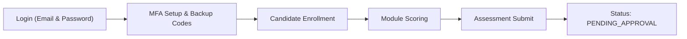
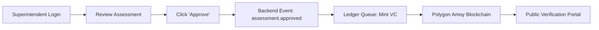

# National Skills Passport (NSP) — User Acceptance Testing (UAT) Guide

**Document Version:** 1.0.0  
**Target Release:** MVP Production Release  
**Last Updated:** November 2026  
**Environment:** AWS Production (S3 + CloudFront CDN + EC2 + RDS PostgreSQL + Polygon Amoy Testnet)

---

## 1. Executive Summary & Purpose

The purpose of this User Acceptance Testing (UAT) document is to provide a formal, end-to-end testing protocol for the **National Skills Passport (NSP)** system.

Testing responsibilities are divided into two parallel tracks:
* **Track 1 (Frontend & Portal Tester)**: Validates user interface workflows, trade testing operations, candidate enrollment, MFA setup, backup recovery codes, and responsive portal behavior.
* **Track 2 (Backend & Blockchain Tester)**: Validates administrative approvals, automated ledger queue dispatching, Polygon Amoy blockchain smart contract execution, credential verification, and cryptographic tampering resistance.

---

## 2. System Under Test (SUT) Reference Matrix

| Component | Target URL / Address | Protocol / Port | Notes |
|---|---|---|---|
| **Portal Web Application (Frontend)** | `https://d2b8htsqiivt1y.cloudfront.net` | HTTPS (443) | S3-backed SPA via CloudFront CDN |
| **Backend REST API** | `https://d3i78mgqzvnaho.cloudfront.net` | HTTPS (443) | Node.js / Express on EC2 via CloudFront CDN |
| **Backend Health Endpoint** | `https://d3i78mgqzvnaho.cloudfront.net/health` | HTTPS (443) | Status probe: returns `{"status":"ok"}` |
| **Blockchain Network** | Polygon Amoy Testnet | Chain ID: `80002` | RPC: Infura Polygon Amoy Provider |
| **Relayer Gas Wallet** | `0x0fFDd42368714d1D7590778a27b714B594b9d9C3` | On-Chain | Automated credential minter wallet |
| **Block Explorer** | [Polygon Amoy Explorer](https://amoy.polygonscan.com/) | Web GUI | Transaction & Smart Contract inspector |

---

## 3. Test Credentials & Account Directory

All 10 hub accounts have been seeded with the baseline test password:  
**`TestPass123!`**

### Track 1 Accounts (Trade Testers)
| Hub Location | Login Email | Assigned Role |
|---|---|---|
| **Hub 1 (Islamabad)** | `tradetester.hub1@nsp.com` | `TRADE_TESTER` |
| **Hub 2 (Lahore)** | `tradetester.hub2@nsp.com` | `TRADE_TESTER` |
| **Hub 3 (Karachi)** | `tradetester.hub3@nsp.com` | `TRADE_TESTER` |
| **Hub 4 (Peshawar)** | `tradetester.hub4@nsp.com` | `TRADE_TESTER` |
| **Hub 5 (Quetta)** | `tradetester.hub5@nsp.com` | `TRADE_TESTER` |

### Track 2 Accounts (Superintendents)
| Hub Location | Login Email | Assigned Role |
|---|---|---|
| **Hub 1 (Islamabad)** | `superintendent.hub1@nsp.com` | `SUPERINTENDENT` |
| **Hub 2 (Lahore)** | `superintendent.hub2@nsp.com` | `SUPERINTENDENT` |
| **Hub 3 (Karachi)** | `superintendent.hub3@nsp.com` | `SUPERINTENDENT` |
| **Hub 4 (Peshawar)** | `superintendent.hub4@nsp.com` | `SUPERINTENDENT` |
| **Hub 5 (Quetta)** | `superintendent.hub5@nsp.com` | `SUPERINTENDENT` |

---

## 4. Track 1: Frontend & Portal Test Plan

**Tester Role:** Testing Officer / Trade Tester  
**Primary Objective:** Verify seamless operator workflow from authentication to assessment submission.



---

### TC-FE-01: First-Time Login & Mandatory TOTP Enrollment
* **Pre-condition**: Browser opened at `https://d2b8htsqiivt1y.cloudfront.net` (Incognito recommended).
* **Test Steps**:
  1. Enter email `tradetester.hub1@nsp.com` and password `TestPass123!`. Click **Sign In**.
  2. Confirm redirect to the **MFA Enrollment Setup** screen.
  3. Scan the displayed QR code with Google Authenticator or Microsoft Authenticator on your mobile device.
  4. Enter the 6-digit verification code from your authenticator app.
  5. Click **Verify & Activate MFA**.
* **Expected Result**: 
  * Authenticator code is accepted.
  * System displays a set of **10 single-use Backup Recovery Codes**.
  * User can copy/download codes and is granted access to the Trade Tester Dashboard.
* **Status**: [ ] Pass &nbsp;&nbsp; [ ] Fail

---

### TC-FE-02: Candidate Registration & Enrolment Quota (FR-CAND-01)
* **Pre-condition**: Authenticated as Trade Tester on Dashboard.
* **Test Steps**:
  1. Click **Enrollment** / **Register Candidate**.
  2. Fill in candidate details:
     * **Full Name**: `Muhammad Ali`
     * **CNIC / National Identifier**: `37405-1234567-1`
     * **Date of Birth**: `1995-05-15`
     * **Trade Category**: `Welding & Fabrication`
     * **Testing Hub**: `Hub 1 - Islamabad`
  3. Submit the registration form.
* **Expected Result**:
  * Candidate is assigned a unique **Candidate ID** (UUID format).
  * Candidate status displays as `ENROLLED`.
  * The daily hub enrollment quota widget accurately increments by 1.
* **Status**: [ ] Pass &nbsp;&nbsp; [ ] Fail

---

### TC-FE-03: Assessment Evaluation & Score Entry
* **Pre-condition**: Candidate from TC-FE-02 is listed in active candidates.
* **Test Steps**:
  1. Navigate to **Assessments** ➔ **New Assessment**.
  2. Select candidate `Muhammad Ali`.
  3. Enter assessment breakdown:
     * **Module 1 (Occupational Safety)**: `85` / 100
     * **Module 2 (Practical Blueprint Welding)**: `92` / 100
     * **Module 3 (Inspection & Quality)**: `88` / 100
  4. Select Final Competency Grade: `Competent / Grade A`.
  5. Click **Submit Assessment for Superintendent Approval**.
* **Expected Result**:
  * Form validates module inputs without calculation errors.
  * Status transition occurs: `DRAFT` ➔ `SUBMITTED`.
  * Success toast/notification confirms submission to approval queue.
* **Status**: [ ] Pass &nbsp;&nbsp; [ ] Fail

---

### TC-FE-04: Device Authorization & Browser Fingerprinting (B3)
* **Pre-condition**: Logged in to the portal.
* **Test Steps**:
  1. Navigate to **Settings** ➔ **Authorized Devices**.
  2. Inspect the current session card.
* **Expected Result**:
  * Current browser device fingerprint is recognized and labeled as `Current Device / Authorized`.
  * Displays user agent details, IP address, and authorization timestamp.
* **Status**: [ ] Pass &nbsp;&nbsp; [ ] Fail

---

### TC-FE-05: Offline Resilience & Network Indicator
* **Pre-condition**: Portal loaded in browser.
* **Test Steps**:
  1. Open Browser DevTools (F12) ➔ **Network** tab.
  2. Change Network Throttling dropdown from *No Throttling* to **Offline**.
  3. Observe UI header and attempt to navigate pages.
  4. Switch Network Throttling back to **Online**.
* **Expected Result**:
  * An ambient **"Offline Mode — Read Only"** banner appears automatically.
  * Local state remains preserved without full application crash.
  * When switched back to Online, the offline warning dismisses automatically.
* **Status**: [ ] Pass &nbsp;&nbsp; [ ] Fail

---

---

## 5. Track 2: Backend & Blockchain Test Plan

**Tester Role:** Verification Officer / Blockchain Auditor  
**Primary Objective:** Verify administrative controls, cryptographic integrity, automated ledger queue dispatching, and Polygon Amoy testnet state.



---

### TC-BC-01: Superintendent Review & Approval Workflow
* **Pre-condition**: Assessment from TC-FE-03 is pending approval.
* **Test Steps**:
  1. Open `https://d2b8htsqiivt1y.cloudfront.net` in a fresh window.
  2. Log in with `superintendent.hub1@nsp.com` / `TestPass123!`.
  3. Complete TOTP MFA enrollment setup.
  4. Navigate to **Approvals** screen.
  5. Select candidate `Muhammad Ali` from the approval queue.
  6. Review candidate scores and click **Approve & Issue Credential**.
* **Expected Result**:
  * Assessment status changes from `SUBMITTED` to `APPROVED`.
  * Audit log entry records superintendent ID and approval timestamp.
  * Backend event `assessment.approved` fires automatically.
* **Status**: [ ] Pass &nbsp;&nbsp; [ ] Fail

---

### TC-BC-02: Automated Ledger Queue & On-Chain Minting
* **Pre-condition**: TC-BC-01 executed successfully.
* **Test Steps**:
  1. Navigate to **Credentials** tab on the portal.
  2. Locate the freshly generated credential for `Muhammad Ali`.
  3. Verify presence of:
     * **Credential ID**: `urn:uuid:...`
     * **Issuance Date**: Current UTC date/time
     * **Status**: `ISSUED`
     * **Transaction Hash**: `0x...` (66-character hexadecimal string)
* **Expected Result**:
  * Credential record exists in database and UI.
  * Valid Ethereum/Polygon transaction hash is populated without manual relayer trigger.
* **Status**: [ ] Pass &nbsp;&nbsp; [ ] Fail

---

### TC-BC-03: Polygonscan Explorer Proof-of-State Verification
* **Pre-condition**: Transaction hash obtained from TC-BC-02.
* **Test Steps**:
  1. Open [Polygon Amoy Testnet Explorer](https://amoy.polygonscan.com/).
  2. Paste the Transaction Hash into the search bar.
  3. Inspect transaction details:
     * **Status**: `Success` (Green checkmark)
     * **From**: Relayer address `0x0fFDd42368714d1D7590778a27b714B594b9d9C3`
     * **Block Confirmation**: Confirmed (at least 1 block confirmation)
* **Expected Result**:
  * Transaction exists on Polygon Amoy public ledger.
  * Gas used is accounted for and call succeeded.
* **Status**: [ ] Pass &nbsp;&nbsp; [ ] Fail

---

### TC-BC-04: Public QR Code & Tamper-Proof Verification
* **Pre-condition**: Credential ID / QR payload obtained.
* **Test Steps**:
  1. Log out or open a private window at `https://d2b8htsqiivt1y.cloudfront.net/verify`.
  2. Enter the valid Credential ID (or scan the digital credential QR code).
  3. Click **Verify Authenticity**.
* **Expected Result**:
  * Verification badge: **AUTHENTIC & VALID**.
  * Shows candidate name, trade category, grade, issuing hub, and smart contract verification check.
* **Negative Test (Tampering Detection)**:
  * Alter a single character in the Credential ID and click Verify.
  * System displays: **INVALID CREDENTIAL / NOT FOUND**.
* **Status**: [ ] Pass &nbsp;&nbsp; [ ] Fail

---

### TC-BC-05: Credential Revocation On-Chain & Invalidation
* **Pre-condition**: Credential issued from TC-BC-02.
* **Test Steps**:
  1. Log in as Superintendent (`superintendent.hub1@nsp.com`).
  2. Navigate to **Credential Management** ➔ **Revoke Credential**.
  3. Select the test credential.
  4. Enter Revocation Reason: `UAT Administrative Lifecycle Test`.
  5. Confirm revocation.
  6. Return to public verification page (`/verify`) and check the credential again.
* **Expected Result**:
  * Superintendent dashboard marks credential as `REVOKED`.
  * Public verification immediately reflects: **REVOKED — This credential is no longer valid**.
* **Status**: [ ] Pass &nbsp;&nbsp; [ ] Fail

---

### TC-BC-06: Production API Health & Server Metrics
* **Pre-condition**: Public network access.
* **Test Steps**:
  1. Open in browser: `https://d3i78mgqzvnaho.cloudfront.net/health`.
  2. Check response payload and HTTP status code.
* **Expected Result**:
  * HTTP Status: `200 OK`.
  * Response body:
    ```json
    {
      "status": "ok",
      "timestamp": "2026-..."
    }
    ```
* **Status**: [ ] Pass &nbsp;&nbsp; [ ] Fail

---

## 6. End-to-End "Golden Flow" Execution Sequence

To perform a complete joint test across both roles, follow this unified 6-step lifecycle:

| Sequence | Actor | Action | Milestone Output |
|---|---|---|---|
| **1** | **Person 1** | Enrolls Candidate `Muhammad Ali` | Candidate Record created |
| **2** | **Person 1** | Submits Trade Assessment (Scores: 85, 92, 88) | Assessment `SUBMITTED` |
| **3** | **Person 2** | Reviews & Approves Assessment | Assessment `APPROVED` |
| **4** | **System (Auto)** | Event listener auto-dispatches ledger queue | Tx broadcast to Polygon Amoy |
| **5** | **Person 2** | Verifies Tx on Polygonscan | On-Chain confirmation `0x...` |
| **6** | **Both** | Verifies Credential via Public QR Reader | Status `AUTHENTIC & VALID` |

---

## 7. Defect Severity & Reporting Protocol

If an unexpected behavior occurs during testing, record a defect using the following classification:

* **P1 (Blocker)**: System crash, unable to log in, database connection failure, or blockchain queue stuck.
* **P2 (Major)**: Core business rule failed (e.g. assessment submitted without required fields, score calculation error).
* **P3 (Minor)**: Visual misalignment, layout defect, or non-blocking typo.

### Defect Report Template
```text
Issue ID: DEF-001
Track: [Frontend / Backend]
Test Case ID: TC-FE-02
Severity: [P1 / P2 / P3]
Summary: Brief description of the issue
Steps to Reproduce:
1. Log in as ...
2. Click on ...
Actual Result: What actually happened (include screenshot / error text)
Expected Result: What should have happened per UAT guide
Browser/OS: Windows 11 / Chrome v130
```

---

## 8. UAT Sign-Off Certificate

| Role | Signee Name | Date | Recommendation | Signature |
|---|---|---|---|---|
| **Frontend UAT Lead** | ____________________ | ___________ | [ ] Accept &nbsp; [ ] Reject | ____________________ |
| **Blockchain / Backend Lead** | ____________________ | ___________ | [ ] Accept &nbsp; [ ] Reject | ____________________ |
| **Project Sponsor / Lead** | ____________________ | ___________ | [ ] Production Release Approved | ____________________ |
